# Awesome Warehouse Management System (WMS) 📦⚡

  

  
  
  
  

> 🌟 **A curated directory of top Warehouse Management System (WMS) solutions** — comparing enterprise SaaS platforms and self-hosted open-source software for inventory control, automated picking & packing, 3PL client billing, barcode/RFID scanning, and robotics orchestration. 🚀✨

---

## 📋 Table of Contents 📑

- [Sector Overview & Market Dynamics 🌐](#-sector-overview--market-dynamics-)
- [SaaS / Hosted Platforms 🟦](#-saas--hosted-platforms-)
- [Open-Source Software 🟩](#-open-source-software-)
- [Comparison at a Glance 📊](#-comparison-at-a-glance-)
- [📈 Star History](#-star-history)
- [💖 Support & Community 🙏](#-support--community-)
- [🤝 Contributing 💡](#-contributing-)
- [📄 License ⚖️](#-license-️)

---

## 🌐 Sector Overview & Market Dynamics 📈

The global Warehouse Management System (WMS) market is estimated at **$4.0 billion to $4.8 billion in 2026** (expanding toward $10+ billion by the early 2030s at an aggressive CAGR of ~15–19%), accelerated by omnichannel e-commerce fulfillment, autonomous mobile robots (AMRs), and AI-driven supply chain automation. The sector exhibits a **moderately concentrated yet hybrid market structure**: an enterprise oligopoly of tier-1 tech giants (Oracle, Manhattan Associates, Blue Yonder, Infor, and Körber) commands roughly 35–42% of global market share, while a vibrant, fragmented long-tail of specialized 3PL cloud platforms and active open-source ecosystems caters to SMBs, regional distributors, and agile digital brands. 🏬🤖

---

## 🟦 SaaS / Hosted Platforms ☁️

Commercial, cloud-hosted Warehouse Management System platforms. Sorted in descending order by company scale (market capitalization, valuation, or parent company annual revenue). 🏢📊

| Platform 🚀 | Company Scale / Valuation 💰 | Starting Pricing Tier 🏷️ | Free Tier / Free Trial Limits 🎁 | Key Capabilities & Architecture 🛠️ |
|:---|:---|:---|:---|:---|
| **[Oracle NetSuite WMS](https://www.netsuite.com/portal/products/erp/warehouse-management-system.shtml)** | **~$380B Market Cap** *(Oracle Corp / $53B+ ARR)* | **~$1,999/month** *(~$999/mo base ERP + $1,000/mo WMS module, billed annually)* | **No free tier**; 14-to-30 day guided demo sandbox upon sales approval (pre-populated demo data, no live hardware/scanner sync) | Native ERP integration, RF mobile picking/putaway, multi-location inventory, wave release, cross-docking, and landed-cost calculation. |
| **[Blue Yonder WMS](https://blueyonder.com/solutions/warehouse-management)** | **~$28B Valuation** *(Subsidiary of Panasonic Holdings / $58B+ ARR)* | **~$20,000/month** *($240,000/year enterprise license baseline)* | **No free tier**; structured guided enterprise proof-of-concept (PoC) demo on request (no self-serve trial) | Microservices-based SaaS, pull-based streaming order release, dynamic slotting AI, camera-based yard management, and AMR robotics coordination. |
| **[Infor CloudSuite WMS](https://www.infor.com/products/cloudsuite-wms)** | **~$13B Valuation** *(Subsidiary of Koch Industries / $125B+ ARR)* | **~$3,000/month** *(Typically ~$150–$350/user/mo with minimum seat volume commitments)* | **No free tier**; custom sandbox pilot arranged for qualified enterprise RFPs (no public trial) | Tier-1 multi-tenant distribution DC management, 3D visual warehouse analysis, embedded labor management, 3PL customer billing, and voice/RF picking. |
| **[Manhattan Active Warehouse Management](https://www.manh.com/products/warehouse-management)** | **~$12.5B Market Cap** *(NASDAQ: MANH / ~$1.0B ARR)* | **~$15,000/month** *(~$180,000/year per distribution center; or ~$2,000/user/year)* | **No free tier**; enterprise interactive sandbox environment accessible via sales executive demonstration only | 100% microservices cloud-native architecture, autonomous warehouse AI agents, unified distribution & transportation orchestration, continuous zero-downtime upgrades. |
| **[Zoho Inventory](https://www.zoho.com/inventory/)** | **~$1.2B Annual Revenue** *(Zoho Corporation, bootstrapped)* | **$29/month** *(billed annually; or $39/mo billed monthly)* | **Free forever plan**: 50 orders/month, 50 shipping labels/month, 1 user, 1 warehouse location; or 14-day free trial of all paid features | Lightweight multi-channel inventory control, barcode generation/scanning, serial & batch tracking, Shopify/Amazon connectors, and automated purchase orders. |
| **[Körber (Infios Warehouse Edge)](https://www.koerber-supplychain-software.com/)** | **~$1.0B+ Revenue** *(Körber Supply Chain Software / Körber AG Group)* | **~$3,500/month** *(Implementation & licensing starting from ~$150,000 total first year)* | **No free tier**; interactive simulated warehouse walkthrough via specialized solutions architect (no public self-serve trial) | Formerly HighJump WMS; advanced AMR/cobot fleet orchestration, voice-directed picking (Vocollect), dynamic cold-chain and 3PL multi-client workflows. |
| **[Deposco (Bright Suite)](https://www.deposco.com/)** | **~$800M Valuation** *(Backed by Generation Investment Management & Rubicon)* | **~$2,500/month** *(Starting tier based on order throughput and core modules)* | **No free tier**; custom vendor evaluation sprint and tailored sandbox demo (no self-serve free trial) | Lightspeed rapid deployment (4–8 weeks), Bright Warehouse AI batch wave routing, pre-built integrations with AutoStore/Locus Robotics, and parcel rate shopping. |
| **[ShipHero](https://shiphero.com/)** | **~$250M Valuation** *(High-velocity DTC fulfillment leader)* | **$1,995/month** *(Standard Brand WMS, includes 5 users, unlimited orders/SKUs)* | **No free tier**; live guided scanner workflow trial for enterprise deals (no automated public self-serve trial) | High-speed mobile iOS barcode scanning, batch picking routes, multi-carrier label generation with 150+ carriers, customer returns portal, and 3PL client billing. |
| **[Logiwa IO](https://www.logiwa.com/)** | **~$150M Valuation** *(Series B funded by NewView Capital, Valor)* | **$1,500/month** *(Volume-based fulfillment plan with unlimited users)* | **No free tier**; complimentary AI proof-of-concept (POC) demo for qualified high-volume warehouses (no self-serve free trial) | High-velocity DTC & 3PL WMS, AI order batching, algorithmic labor tracking, automated contract billing for multi-client 3PLs, and no-code rule automation. |
| **[Fishbowl Warehouse](https://www.fishbowlinventory.com/)** | **~$100M Valuation** *(Acquired by Diversis Capital)* | **$229/month** *(Essentials Plan, billed annually; Advanced WMS starts from $595/mo)* | **No free tier**; 14-day full-access guided trial upon scheduling discovery with an onboarding specialist | Gold-standard QuickBooks integration, multi-location stock control, manufacturing BOM assembly, lot/serial traceability, and mobile handheld barcoding. |

---

## 🟩 Open-Source Software 💻

Self-hosted, community-driven, and developer-friendly Warehouse Management Systems. Sorted in descending order by GitHub Stars_Count. 🌟🔓

| Software 📦 | GitHub_Stars ⭐ | Stack & Framework ⚙️ | License 📜 | Best For 🎯 |
|:---|:---|:---|:---|:---|
| **[Odoo WMS (Community)](https://github.com/odoo/odoo)** |  | Python / PostgreSQL / JavaScript | LGPL-3.0 | Complete ERP-integrated inventory and warehouse logistics with barcode scanning, double-entry inventory, and automated replenishment. |
| **[ERPNext (Stock & WMS)](https://github.com/frappe/erpnext)** |  | Python (Frappe) / MariaDB / Vue.js | GPL-3.0 | Modern, 100% open-source enterprise suite featuring multi-warehouse tracking, serialized batches, delivery notes, and stock reconciliation. |
| **[InvenTree](https://github.com/inventree/InvenTree)** |  | Python / Django / React | MIT | Lightweight modular inventory and parts tracking designed for light manufacturing, assembly operations, and stockrooms. |
| **[GreaterWMS](https://github.com/GreaterWMS/GreaterWMS)** |  | Python / Django / Rust / Vue (Quasar) | Apache-2.0 | High-performance standalone WMS supporting PDA scanners, mobile apps, multi-tenant 3PLs, cross-border e-commerce, and cold-chain logistics. |
| **[ModernWMS](https://github.com/fjykTec/ModernWMS)** |  | .NET 8 / Vue.js 3 / TypeScript | MIT | Clean, minimalist cross-platform warehouse management system optimized for rapid SME inventory receipts, order dispatches, and location management. |
| **[Asp.Net Core WMS](https://github.com/go2ismail/Asp.Net-Core-Inventory-Order-Management-System)** |  | .NET 9 / Vue.js / Clean Architecture | MIT | Headless API and Razor Pages architecture implementing CQRS, MediatR, and full order-to-dispatch warehouse workflows. |
| **[wms-ruoyi](https://github.com/zccbbg/wms-ruoyi)** |  | Java (Spring Boot) / Vue.js / Element UI | MIT | Warehouse zone management, web printing (Lodop) for inbound/outbound notes, carrier management, and dynamic inventory dashboard kanbans. |
| **[OpenBoxes](https://github.com/openboxes/openboxes)** |  | Groovy / Grails / MySQL | Eclipse Public License | Specialized healthcare supply chain & hospital warehouse system with lot expiry tracking, cold-chain monitoring, and replenishment requisitions. |
| **[frePPLe](https://github.com/frePPLe/frepple)** |  | C++ / Python / PostgreSQL | AGPL-3.0 | Upstream supply chain planning, finite-capacity production scheduling, and warehouse inventory optimization algorithms. |
| **[OpenWMS.org](https://github.com/openwms/org.openwms)** |  | Java (Spring Cloud) / Microservices | Apache-2.0 | Modular reference implementation of core warehouse transport management, storage locations, automated AS/RS interfaces, and picking. |
| **[warehouse-inventory-system](https://github.com/siamon123/warehouse-inventory-system)** |  | PHP / MySQL / Bootstrap | MIT | Straightforward web-based inventory tracker with supplier management, sales/purchase order handling, and PDF invoice dispatch. |
| **[OCA WMS (Odoo Addons)](https://github.com/OCA/wms)** |  | Python / Odoo Framework | AGPL-3.0 | Community-maintained advanced logistic modules extending native Odoo stock with complex wave picking, multi-step routing, and cross-dock logic. |
| **[JeeWMS](https://github.com/erzhongxmu/JeeWMS)** |  | Java / Spring MVC / MyBatis / MySQL | Apache-2.0 | Enterprise Java WMS featuring wave picking, barcode generation, inventory valuation, and multi-warehouse stock allocations. |
| **[myWMS](https://github.com/wms2/mywms)** |  | Java / JEE / WildFly | GPL-3.0 | Longstanding open-source WMS platform supporting manual and automated warehouse facilities, forklift terminals, and storage zone control. |

---

## 📊 Comparison at a Glance 🔍

| System 🏷️ | Deployment Model 🌐 | Architecture / Stack 🛠️ | Open Source? 🔓 | Free Tier / Trial? 🎁 | Best Operational Fit 🎯 |
|:---|:---|:---|:---|:---|:---|
| **Oracle NetSuite WMS** | Cloud SaaS | Multi-tenant ERP Cloud | ❌ Proprietary | ❌ (Sales Demo) | Standardized NetSuite ERP enterprises |
| **Blue Yonder WMS** | Cloud SaaS | Microservices / AI Event Streaming | ❌ Proprietary | ❌ (Guided PoC) | Large global fulfillment networks & continuous flow |
| **Infor CloudSuite WMS** | Cloud SaaS / Hybrid | AWS Multi-tenant Cloud | ❌ Proprietary | ❌ (Enterprise RFP) | 3PL logistics with labor & 3D visual analysis |
| **Manhattan Active WM** | Cloud SaaS | Cloud-Native Microservices | ❌ Proprietary | ❌ (Sales Demo) | Massive, automated high-throughput mega distribution centers |
| **Zoho Inventory** | Cloud SaaS | Cloud Web & Mobile App | ❌ Proprietary | ✅ (Free forever plan: 50 orders/mo) | SMB ecommerce sellers seeking budget-friendly multi-channel |
| **Körber Infios** | Cloud / On-Premise | Modular Client-Server & Cloud | ❌ Proprietary | ❌ (Architect Walkthrough) | Automation-heavy sites integrating AMRs and voice picking |
| **Deposco Bright Suite** | Cloud SaaS | Cloud Omnichannel Fulfillment | ❌ Proprietary | ❌ (Vendor Evaluation) | Fast-growth omnichannel retailers deploying AS/RS robotics |
| **ShipHero** | Cloud SaaS | iOS Native Scanner App & Cloud | ❌ Proprietary | ❌ (Guided Demo) | Scanner-heavy DTC brands & scaling 3PL fulfillment hubs |
| **Logiwa IO** | Cloud SaaS | Cloud-Native Microservices | ❌ Proprietary | ❌ (Free AI PoC) | High-volume B2C ecommerce & automated 3PL billing |
| **Fishbowl Warehouse** | Cloud / On-Premise | Client-Server / Hosted | ❌ Proprietary | ❌ (14-Day Assisted Trial) | Manufacturers & distributors requiring QuickBooks sync |
| **Odoo WMS (Community)** | Self-Hosted | Python / PostgreSQL | ✅ LGPL-3.0 | ✅ (100% Free Open Source) | Full ERP + double-entry inventory tracking |
| **ERPNext** | Self-Hosted / Cloud | Python / Frappe / MariaDB | ✅ GPL-3.0 | ✅ (100% Free Open Source) | Modern open-source ERP with integrated stock & warehouse |
| **InvenTree** | Self-Hosted | Python / Django / React | ✅ MIT | ✅ (100% Free Open Source) | Lightweight inventory & assembly part tracking |
| **GreaterWMS** | Self-Hosted | Python / Django / Rust / Quasar | ✅ Apache-2.0 | ✅ (100% Free Open Source) | Mobile PDA-driven 3PL, pharma, and cross-border WMS |
| **ModernWMS** | Self-Hosted | .NET 8 / Vue.js 3 | ✅ MIT | ✅ (100% Free Open Source) | Clean, rapid-install inventory and dispatch for SMEs |
| **OpenBoxes** | Self-Hosted | Groovy / Grails / MySQL | ✅ EPL | ✅ (100% Free Open Source) | Hospitals, medical clinics, and public health supplies |
| **frePPLe** | Self-Hosted | C++ / Python / PostgreSQL | ✅ AGPL-3.0 | ✅ (100% Free Open Source) | Upstream supply chain & production planning optimization |
| **OpenWMS.org** | Self-Hosted | Java / Spring Boot Microservices | ✅ Apache-2.0 | ✅ (100% Free Open Source) | Java developers building custom modular WMS stacks |

---

## 📈 Star History

---

## 💖 Support & Community 🙏

Thank you so much for exploring this curated repository! If this guide helped you discover the right Warehouse Management System, optimize your distribution center logistics, or streamline your supply chain workflows, please consider showing your support:

- ⭐ **Star this repository** to help other supply chain managers, warehouse operators, and software engineers discover it!
- 🍴 **Fork and share** it with your engineering team, logistics community, and colleagues.
- ☕ **Buy me a coffee / Sponsor**: If you appreciate this curated repository and would like to support continuous maintenance, new tool reviews, and active updates, please visit the [GitHub Sponsor Dashboard](https://github.com/sponsors/ishandutta2007). Every bit of support is deeply appreciated! ☕✨

---

## 🤝 Contributing 💡

Contributions are warmly welcomed! If you know of an active open-source Warehouse Management System or an updated enterprise SaaS platform that should be included:

1. Fork this repository. 🍴
2. Ensure the platform or project is actively maintained and relevant to warehouse logistics, inventory control, or supply chain execution. 🔍
3. For open-source projects, include the official GitHub_Stars_Badge (`https://img.shields.io/github/stars/<owner>/<repo>?style=social&color=white`) linking to its stargazers page. ⭐
4. Submit a clear pull request with a concise overview of the platform, technology stack, and distinguishing features. 🚀

---

## 📄 License ⚖️

This repository and curated list are released under the [Creative Commons Zero v1.0 Universal](https://creativecommons.org/publicdomain/zero/1.0/) (Public Domain). Respective trademarks, logos, and software projects belong to their individual owners. 🌐✨
